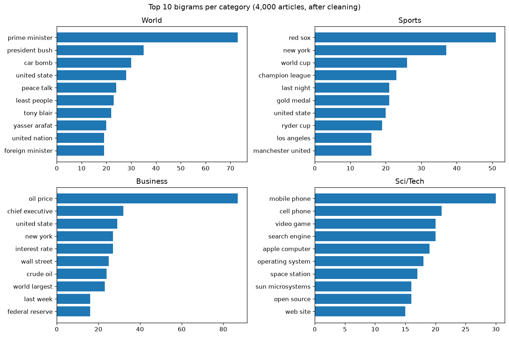

# AI Engineer Bootcamp

Hands-on projects built while taking **The AI Engineer Course 2026: Complete AI Engineer Bootcamp** (365 Careers, Udemy).
The code is my own. The course notebooks and datasets are not included.

| Project | What it shows | Status |
|---|---|---|
| [NLP pipeline](#nlp-pipeline-ag-news) | Every technique from the course's NLP module, in one script, on 120k real news articles | 🚧 stage 1 of 7 |

---

## NLP pipeline (AG News)

[`nlp/nlp_pipeline.py`](nlp/nlp_pipeline.py) runs a full NLP workflow on
[AG News](https://huggingface.co/datasets/fancyzhx/ag_news): 120,000 news articles labelled World, Sports, Business or Sci/Tech.
The analysis stages use a stratified sample of 4,000 articles (1,000 per category).

| Stage | Techniques | Status |
|---|---|---|
| 1. Preprocessing | regex cleanup, lowercasing, tokenization, stop words, stemming vs lemmatization, n-grams | ✅ |
| 2. POS & NER | part-of-speech tagging, named entity recognition | ⏳ |
| 3. Sentiment | rule-based (VADER) vs pre-trained transformer | ⏳ |
| 4. Vectorizing | bag of words vs TF-IDF, cosine similarity | ⏳ |
| 5. Topic modelling | LDA, LSA, choosing the number of topics | ⏳ |
| 6. Text classifier | logistic regression vs naive Bayes vs linear SVM | ⏳ |
| 7. Case study | what the stages say together | ⏳ |

### Run it

```bash
python -m venv .venv
.venv\Scripts\activate            # macOS/Linux: source .venv/bin/activate
pip install -r nlp/requirements.txt
python nlp/nlp_pipeline.py                     # all stages
python nlp/nlp_pipeline.py --stage preprocess  # one stage
```

The first run downloads AG News from Hugging Face and the NLTK word lists; both are cached afterwards.
Charts and tables are saved to [`nlp/results/`](nlp/results/).

### Stage 1: Preprocessing

The raw text is messy. Apostrophes arrive as `#39;`, dollar signs as `#36;`, HTML is escaped (`&lt;strong&gt;`), and
many articles start with agency boilerplate like `NEW YORK (Reuters) - ` or contain stock links like
`(MLS.N: Quote, Profile, Research)`. Regex cleanup fixes all of it before tokenizing
([examples](nlp/results/cleaning_examples.md)).



- **2,174 of 4,000 articles (54%)** had encoding junk or agency tags. After cleanup: **0**.
- **Stemming vs lemmatization:** stemming cuts the vocabulary from 15,900 to 11,392 words (−28%) but produces non-words
  ("companies" → "compani"). Lemmatization only reaches 14,210 (−11%) but keeps real words ("companies" → "company").
  [Table](nlp/results/stem_vs_lemma.md)
- **Bigrams almost classify the articles by themselves:** "oil price" (Business), "red sox" (Sports),
  "prime minister" (World), "mobile phone" (Sci/Tech). [Trigrams](nlp/results/top_trigrams.md)
- **Gotcha:** lemmatizing word by word turns "United States" into "united state". Multi-word names need
  named entity recognition (stage 2).
- **Regex extraction:** 16.7% of Business articles mention a dollar amount, compared with 1.6% of World articles.
  [Table](nlp/results/money_mentions.md)

---

*AG News was introduced by Zhang, Zhao & LeCun (2015), "Character-level Convolutional Networks for Text Classification".*
